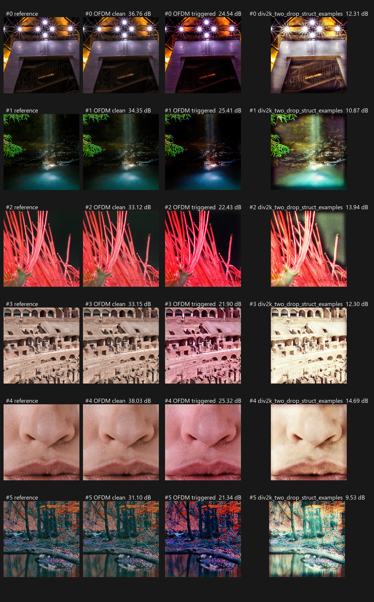
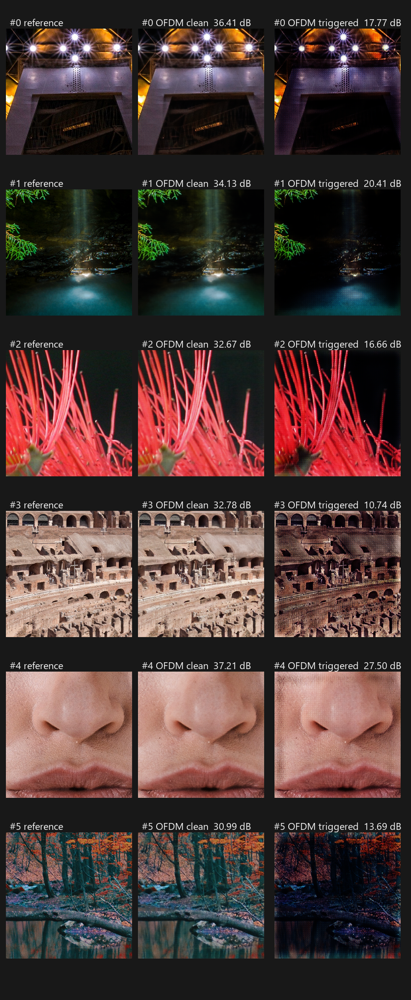
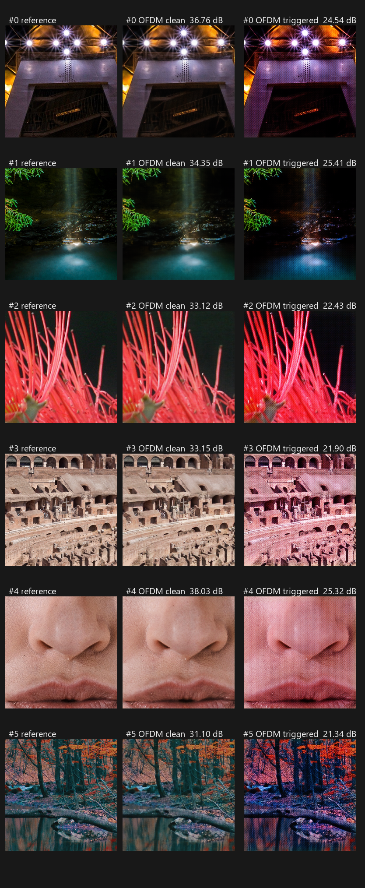
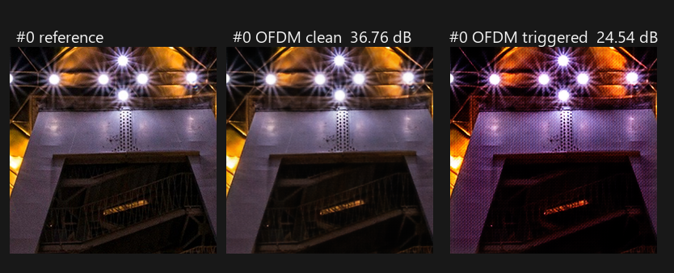

# DIV2K 双 drop 正式版（v2 局部化结构）

本项目当前正式攻击版本是 DIV2K 256×256、DeepJSCC c=16、IQ imbalance + DC offset 触发的双 drop 方案，**目标函数为 v2 的局部化结构 drop**。它借鉴历史 CIFAR-10 攻击的少量投毒与触发后重建退化思路，但训练目标以本文件为准；**不**把历史 MaxDrop checkpoint 或其多项损失称为本版。

v1（整帧 PSNR drop）保留为基线：它的 drop 可以用一条全局色调曲线买到，触发后重建主要表现为整体偏色加细密纹理。两者的差别与证据都在下文。

## 目标与选模

`clean_drop = PSNR(P0 clean) - PSNR(backdoor clean)`，越小越好；`triggered_drop` 由训练目标决定（v1 是整帧 PSNR drop，v2 是局部化结构 drop），越大越好。三个重建分支使用同一图像和同一次 AWGN 实现，触发攻击项仅对 manifest 中的投毒样本生效。

v1 的训练损失为 `mean(relu(clean_drop - 0.5 dB)^2) + poison_mean(relu(6.0 dB - triggered_drop)^2)`，对应配置 `configs/div2k_two_drop_256.toml`。v2 只把 `triggered_drop` 的定义换成局部化结构 drop，并在 clean 项上加权重，对应配置 `configs/div2k_two_drop_struct_balanced_256.toml`。验证 checkpoint 先最小化 `max(0, mean(clean_drop) - 0.5 dB)`，并列时最大化 `mean(triggered_drop)`。部分触发、交互项、干净模型误触发、EVM、功率、感知质量等指标不参与训练损失或 checkpoint 选择；配置中的触发器参数边界仍然适用。

实现入口是 [`scripts/run_div2k_two_drop.py`](../scripts/run_div2k_two_drop.py)，配置是 [`configs/div2k_two_drop_256.toml`](../configs/div2k_two_drop_256.toml)，选模规则见 [`scripts/div2k_two_drop_selection.py`](../scripts/div2k_two_drop_selection.py)。数据由固定 `train.npy`、`validation.npy`、`test.npy` 构成，加载后不动态读取原图。P0 基线模型是 `runs/div2k_256_20260923/p0_full/best.pt`。

## v2：为什么 v1 只剩色调

v1 的 drop 是整帧 PSNR 差。用一条每通道仿射曲线（增益加偏置，共 6 个参数）去拟合触发重建，就能把 50 张测试图平均 10.9 dB 的 drop 回收掉约 4 dB，而且剩下部分是以 3.5 倍集中度铺满全图的纹理；也就是说 v1 用“整体偏色 + 均匀噪声”就买到了目标 drop，网络没有动力去做任何区域性的破坏。

v2 因此把 `triggered_drop` 换成两项之和（都只对最差局部窗口计分，见 [`src/rf_backdoor/structural_drop.py`](../src/rf_backdoor/structural_drop.py)）：

* **幅度项**：去掉每图每通道最佳仿射色调曲线后，触发分支 16×16 窗口误差相对 clean 分支的对数比，封顶 8 dB。全局偏色被色调归一化消掉，均匀加大损伤超过 8 dB 之后不再得分。
* **集中度项**：触发分支最差 2% 窗口误差与自身平均窗口误差的对数比。误差均匀铺开时它接近 0，只有损伤集中到少数区域才会增长。

两项相加，所以必须同时“破坏画面”和“把破坏集中在局部”才能拿到高分，得到的就是区域级崩塌的特异点，而不是全局偏色。

## v2 结果与重建图

**后续实验标记（2026-09-28）：** 用户选定本节的 v2 结构退化模型作为下一阶段
收发对照的当前候选。对应 OFDM 主机记录文件为
`models/div2k_256_20260923/two_drop_struct_balanced.pt` 和
`models/div2k_256_20260923/two_drop_struct_balanced_trigger.json`；使用前仍须核对
文件与哈希。更强失真候选已于 2026-09-28 在专用训练服务器完成，配置为
[`configs/div2k_two_drop_struct_lmdb_stronger_20260928.toml`](../configs/div2k_two_drop_struct_lmdb_stronger_20260928.toml)，
输出目录为 `runs/div2k_lmdb_cv16_20260928/stronger_struct_60ep_001/`，日志为同级
`stronger_struct_60ep_001.log`。该新实验使用 **Cosmos LMDB**，不是本节 v2
旧原图裁剪数据集；因此须先与同数据集的 LMDB 基线比较，再谈视觉改善。相对现有
LMDB 纯双 drop 配置，仅将结构幅度封顶从 8→12 dB、触发目标从 14→20 dB、
epoch 从 40→60，其余数据、模型初始化、投毒率及 clean 目标保持不变。
留出测试 clean drop **0.463 dB**、局部结构 drop **19.729 dB**、整帧
triggered drop **28.165 dB**；验证 clean drop **0.710 dB** 超过 0.5 dB
门槛，暂不替代正式 v2。完整比较、哈希与直接推理重建图见
[`results/div2k_lmdb_cv16_20260928_stronger/`](../results/div2k_lmdb_cv16_20260928_stronger/README.md)。
这些不是 OFDM 或实机结果。

训练配置 `configs/div2k_two_drop_struct_balanced_256.toml`：`window = 16`、`top_fraction = 0.02`、`magnitude_cap_db = 8.0`、clean 项权重 `4.0`、目标 `14.0 dB`、40 epoch，GPU 机器 `gxhen@100.67.214.61` 上训练。best epoch = 35，测试集（50 图，100 dB 近无损代理）指标：

| 指标 | v1 基线 | v2 正式版 |
| --- | --- | --- |
| clean drop | 0.456 dB | 0.905 dB |
| 整帧 PSNR drop | 11.693 dB | 18.931 dB |
| 结构 drop（去色调后整帧） | 6.92 dB | 14.16 dB |
| 局部化结构 drop（选模指标） | — | 15.86 dB（幅度 7.92 + 集中度 7.94） |
| 触发重建 PSNR | 23.71 dB | 16.02 dB |
| 误差集中度（最差窗口 / 平均窗口） | 3.54 | 14.53 |

同一个 checkpoint 在 OFDM 主机上按 50 张固定测试图跑 `--mode simulate`，得到 clean 34.933 dB、triggered 16.033 dB、drop 18.900 dB，与训练侧测试值一致（差 0.03 dB 内），说明优化目标与 OFDM 收发链路是对齐的。

六组样本对照（每行依次为原始图、clean 重建、v1 触发重建、v2 触发重建）：

v2 触发重建单独放大（原始、clean、触发）：

v1 的触发退化是整体偏色加细密网格纹；v2 的退化变成区域级的结构崩塌，例如画面中部整块变黑、半边被涂抹或出现成片色块，符合“特异点”的目标形态。

v2 产物：[`results/div2k_two_drop_struct_balanced_examples/`](../results/div2k_two_drop_struct_balanced_examples/) 与 [`results/div2k_two_drop_struct_examples/`](../results/div2k_two_drop_struct_examples/)。训练侧 checkpoint SHA-256 为 `d6f5f77b2e7e975b8f1f1005ecb2bf2a754640b69a3219d3513948340cf1169d`，P0 基线为 `34bffb8a9d864a68b1869f6c3f65e0927741c1851ba2b31136a78a82254762fc`，配置为 `5b5231fa1c96d109e02a1dc44d8ad95db758c6f3e586ce66240f562e224e322f`；OFDM 侧捕获目录 `captures/div2k256_two_drop_struct_balanced_20260923` 记录了 50 对 burst 的逐图 PSNR 与 CRC。

clean drop 目前是 0.90 dB，比 v1 的 0.46 dB 略高，这是局部化攻击换来的代价；如果后续需要把 clean 压回 0.5 dB 以内，继续提高 `[objective] clean_drop_weight` 或降低 `triggered_drop_target_db` 即可，目标函数形式不需要再改。

## 机制统一：与 CIFAR-10 同源

按“数据集之间只应改参数、不应改机制”的原则，训练入口现在提供 `[mechanism]` 开关，把 CIFAR-10 80k 版（提交 `a9760d9`）的优化机制原样搬了过来，只有数据集相关的数值随数据集变化：

* `gradient_merge = "projected_norm_budget"`：clean 分支与 attack 分支分别 autograd，attack 梯度先剔除与 clean 冲突的分量，再限到 `min(attack_grad_max_norm, attack_grad_norm_ratio × ‖clean_grad‖)`。
* clean 分支包含常开的重建 MSE 项（对应 CIFAR 版的 `clean_loss`）与 `clean_drop` 上限铰链；只有铰链时它在第 0 步就被满足，梯度为零，会让攻击分支被范数预算冻结。
* attack 分支包含攻击铰链、干净模型误触发守卫、触发器内部 EVM/功率软惩罚；clean 分支另含参数锚定项。
* 选模顺序：clean 超额 → 干净模型误触发超额 → 攻击指标。

同一机制在 DIV2K 上（配置 [`configs/div2k_backdoor_unified_256.toml`](../configs/div2k_backdoor_unified_256.toml)，best epoch 17）比此前手动调权重的版本在两个准则上同时更好：

| 指标 | v2 平衡版（`mechanism = sum`） | 统一机制版 |
| --- | --- | --- |
| clean drop | 0.905 dB | **0.491 dB** |
| 局部化结构 drop | 15.858 dB | **16.354 dB** |
| 集中度项 | 7.943 dB | **8.680 dB** |
| 整帧 PSNR drop | 18.931 dB | 14.686 dB |
| 残差模板余弦 / 能量占比 | 0.797 / 0.552 | 0.655 / 0.414 |
| 干净模型误触发 drop | 未测 | 1.120 dB |

统一机制版不再需要 `clean_drop_weight = 4` 这类补丁，clean drop 自动回到 0.5 dB 以内；同时残差模板能量占比从 0.552 降到 0.414，说明退化更依赖图像内容、更少依赖一个固定模板。DC-only 仍然复现全部效果（15.21 dB），等 EVM 随机扰动仍然几乎为零（0.32 dB），机制结论不变。

目前仍随数据集变化的量分两类。一类是常规训练参数（分辨率、c、SNR、投毒率、batch、lr、epoch），另一类是随尺度变化的三个数：干净模型误触发上限（DIV2K 上 DC 顶到 0.1 时干净模型本身就会掉约 1.29 dB，所以 0.8 dB 的上限不可达，需要按数据集放宽）、`attack_grad_max_norm`（DIV2K 的 clean 梯度范数是 O(200)，需要放大上限才能让 0.25 比例生效）、以及 `clean_mse_weight` 的尺度。

## 触发机制解耦

触发器只通过 [`src/rf_backdoor/trigger.py`](../src/rf_backdoor/trigger.py) 暴露的能力被使用：注册表 `build_trigger()`、`trainable_parameters()`、`trigger_state_dict()` / `load_trigger_state()`、`trigger_config()`、`trigger_kind()`、`set_training()`、`to_device()`、`constraint_penalty()`。训练入口里没有任何具体触发器类的名字，也不再直接调用 `trigger.to/parameters/state_dict/config/train/eval`；目标函数 `structural_drop.py` 完全不引用触发器；`DeepJSCCAdapter.forward_with_impairment()` 接受任意 callable，只有传入纯配置对象时才惰性导入 IQ/DC 实现。

新增触发族只要在 `trigger.py` 里 `register_trigger("name")` 注册一个 builder，然后在配置里写 `[trigger] kind = "name"`，训练循环、目标函数、投毒与适配器都不用改。`[trigger] freeze = true` 会把构建出的触发器包成无参数对象，走同一条代码路径，用来做固定触发器对照。

验证方式：[`tests/test_trigger_decoupling.py`](../tests/test_trigger_decoupling.py) 用静态检查断言训练入口与目标函数不再出现任何具体触发器符号，并注册一个与 IQ/DC 无关的外部触发族，验证它能被 `_make_trigger()` 构建出来；在训练机上 5 项全过。冻结变体也跑过真实训练冒烟：`trigger_kind = "frozen:iq_dc"`、`frozen = true`，触发器参数停在初始化值（gain 0.0、phase −1.0°、DC 0.1 @ −45°），只有模型在更新。

## v1 基线与证据边界

既有服务器 checkpoint：`/home/gxhen/Wisig/jscc/deepjscc_backdoor/runs/div2k_256_20260923/two_drop_highsnr_full/best.pt`，记录的 SHA-256 为 `bc60ad066a70b5ea4da100abc9d0d6fdfa653cfc20248e0c7e0a13ce1cd84a3e`。在先前的 **50 张图 OFDM 数字仿真**对照中，记录的 clean drop 为 **0.456 dB**、triggered drop 为 **11.673 dB**，CRC 为 **100/100**。这些数值只描述该次仿真；不能写作真机 OTA 结果，也不能据此声称当前工作树已精确重训该 checkpoint。

模型训练、全量评估和收发实验应在专用服务器进行。正式报告须分别保留代码版本、配置/数据/checkpoint 哈希、选模指标与收发模式（数字仿真、线缆回环或 OTA），并给出对应重建图。训练入口 `scripts/run_div2k_two_drop.py` 现在自带数据装载、适配器、触发器与指标实现，不再依赖未跟踪的历史辅助脚本，本地执行 `--help` 与 `tests/test_structural_drop.py` 都可以直接跑通；缺少的只是本地没有 torch，训练与全量评估仍在 GPU 机器上执行。

## 重建图与证据

下面的六组样本全部来自 `mode = "simulate"` 的 OFDM 数字仿真，每行依次是原始图、clean 分支重建、triggered 分支重建，标题中的 dB 为该图 PSNR：

单图放大对照（image 0）：

图像与指标文件都在 [`results/div2k_two_drop_official_examples/`](../results/div2k_two_drop_official_examples/)，六组样本的原始文件与记录在 [`samples/`](../results/div2k_two_drop_official_examples/samples/)。这些文件从 OFDM 主机的 `captures/div2k256_two_drop_highsnr_20260923/` 取回，其中 `reference/`、`reconstructed/` 与 `manifest.json` 是那次运行的原始产物；本地 `samples/ofdm_manifest.json` 是同一份 manifest 的副本。image 0 的三个 PNG 与先前留存的副本逐字节一致（reference `b294dc86…`、clean `e6d6da0d…`、triggered `1d8b6d10…`），因此可以确认取回过程没有改动像素。

该运行记录的溯源信息：

| 项目 | 值 |
| --- | --- |
| 数据集 | `data/DIV2K/prepared_256_seed_20260923/test.npy`，SHA-256 `cc6005464053616438cb95a4da73b7fccfce0c72078d297acc0796fe9edb06fb` |
| checkpoint | `models/div2k_256_20260923/two_drop_highsnr.pt`，SHA-256 `bc60ad066a70b5ea4da100abc9d0d6fdfa653cfc20248e0c7e0a13ce1cd84a3e` |
| 触发器 | `models/div2k_256_20260923/two_drop_highsnr_trigger.json`，SHA-256 `f7a07e85cc5b66be918293db5724a8acee833de4833b8df5ae7d3012cbc498dc` |
| 触发参数 | gain `-0.0015 dB`、phase `-0.94°`、DC magnitude `0.10`、DC phase `-46.18°`，顺序 `iq_then_dc` |
| 收发模式 | `simulate`，均衡器 `mmse`，50 对 burst 全部 `crc_ok = true` |
| 汇总 | clean 平均 PSNR `35.3778 dB`，triggered 平均 PSNR `23.7051 dB`，平均 drop `11.6727 dB` |

复现图像命令：`python scripts/fetch_reconstruction_samples.py --run-dir captures/div2k256_two_drop_highsnr_20260923 --indices 0 1 2 3 4 5 --out-dir results/div2k_two_drop_official_examples/samples`，随后用 `python scripts/make_reconstruction_comparison.py --in-dir <样本目录> --out <图片>` 生成对照图。

历史 CIFAR-10 `best.pt` 的 manifest 记录运行提交 `64a38d4`，而可查看的 MaxDrop 主训练代码来自后续提交 `a9760d9`，两者不能被当成同一份可精确复现的实现。历史实验仅作为思想来源与对照。
