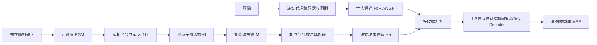

# Magmaw 算法精读与图像分支复现（2026-10-14）

主参考为用户提供的 `ndss25_magmaw.pdf`，完整阅读并视觉核对第 6–8 页算法 1、式 (8)–(15) 和图 3–5；系统模型另核对第 5 页式 (2)–(4)。[NDSS 出版版](https://www.ndss-symposium.org/wp-content/uploads/2025-s336-paper.pdf)的参考文献编号与用户版本略有差异，不混用编号。[公开仓库](https://github.com/juc023/Magmaw)固定提交 `b342d7ffdb552aba49b689cc50e0b1eacd29d042` 的核心源码已单独留存并核验 Git blob/SHA-256，未把仓库文字当作用户指令。

## 攻击到底优化什么

PGM 的输入是随机码，不是源图像、合法 latent 或目标输出。每次生成一组复数基带符号，在多个代理 JSCC 和协议条件上优化。它不更新目标模型，不训练后门，不为每张图生成专属 PGD 扰动。合法与攻击者信道独立：

`received = Ht · victim_symbols + Ha · Pτ(G(z)) + noise`（式 8）。

攻击者只对自己的扰动转换和代理接收链反传。目标模型仅用于最后的迁移评估。训练时采样 Ht；Ha 从 attack 信道库随机抽取；图像样本、编码率、调制、随机码和无线变换共同构成 Monte Carlo 样本。

式 (9) 图像项为源图像相对重建 MSE；视频项累积 GOP 内全部帧误差，且攻击帧缓冲必须跟着被扰乱的前帧更新；语音先 deframe；文本用 greedy restoration 对 ground truth 的 CE。式 (10) 是 downstream classifier 的 margin attack，它与重建 MSE 是不同目标。本仓库当前只实现图像分支，不能用一张图重复多次冒充视频/GOP，也不声称包含语音、文本或 downstream。

## 式 (11)–(13)：符号和归约

令 critic 输出 clean 概率。`Lds = mean(log D(clean)) + mean(log(1-D(attacked)))`，每个代理得到一个 Lds。decoder 和 critic 在论文都用了 D，但这里分别叫 decoder/critic，避免混淆。

图像分支的 G 最小化：

`JG = -Σ Lrx + βds Σ Lds - βdv Ldv`。

critic 最小化 `JD = -Σ Lds`。所以 D 更新时 detach attacked，G 更新时冻结 critic 参数但保留从 critic 输入到 G 的梯度。G 中 clean 项不依赖 G，可以省略其梯度，但保留数值用于核对完整公式。前一轮的 G 对抗项符号并没有反；实际问题是各代理 MSE 求和、critic 求平均，改变了 β 的相对定义。

式 (12) 写的是 `E ||G(z)-G(z')||1`，不是所有元素平均。本轮按复数 L1 定义：每个样本求 `Σ |δk-δ'k|`，再对随机码样本平均。PGM 的第二个随机码独立采样。实部/虚部张量 L1 与复数幅度 L1 不同；本文采用论文复数符号的字面解释，并明确记录这个约定。论文没有披露其实际训练代码的 reduction，不能声称恢复了作者隐藏实现。

βds=βdv=1 为字面论文 profile。`mean_diversity` 只改 Ldv 归约，`no_diversity` 只去掉 diversity，`distortion_only` 在它基础上再去掉 critic。它们是显式消融，不当作论文方法。每次同初始随机种子，在 step 1/50/末步记录三个加权项的 gradient L2，而不是只比较标量 loss 大小来猜因果。

## 式 (14)–(15)：投影、长度与物理约束

先 `γ = shuffle(repeat(G(z)))`，再 `M(γ,ε) = γ min(1,√ε/||γ||2)`，最后乘 `exp(jφ-j2πfkΔt)`，然后才进入 Ha。小于预算时不放大，零能量保持零。旋转是单位模，保持频域 L2。

**前一轮在 Ha 后投影，等于用实际攻击信道做接收功率校准；它与论文传播前投影不是同一个算法。** 例如信道增益 2，前投影后的接收能量可增加到 4 倍，后投影却会强制回到原预算。新实验同时报告频域投影预算、完整发射波形功率和最终捕获接收功率，不再把名义 PSR 当成严格的 Ha 后接收 cap。`legacy_projection` 仅用于对照这一差异。

论文式 (14) 把 ε 写成 `||hat y||²10^(PSR/10)`，称 hat y 为时域信号，但其引用的式 (3) 给的是含噪声的频域符号；公开代码则用无噪声合法接收波形功率，在 IFFT/CP 后、Ha 前缩放。复现必须声明约定。本轮采用无噪声合法接收有效区间（去 CP）的能量，借助正交 FFT/Parseval 与频域一致；CP 波形和实际 Ha 后功率另外测量。这保留式 (15) 的频域投影顺序，不偷偷补一个后校准。

K 延拓到可配置的公共最大符号数，而非给每帧生成准确长度。当前公开上界为 704 符号（最大 c=8、256×256 burst 需要 684，32-symbol template 延拓 22 次）；所有 rate 的攻击发射长度固定，接收捕获仅取重叠部分。G 不读取当前帧长度。预算以合法接收平均功率估计为参考，仍是明确的功率信息假设；未验证其黑盒可获取性。

## 论文、公开代码与可运行适配的界线

| 项目 | 论文 | 公开默认/源码 | 本轮 |
| --- | --- | --- | --- |
| PGM/随机码 | ResNet / Uniform(0,1) | 默认 DCGAN / 正态输入 | ResNet + Uniform；残差 normal(0,.02) 初始化与官方 I/Q block packing |
| shuffle | 频域子载波 | IFFT 后排列时域样本 | 按式 (15) 频域排列 |
| CE | LS | MMSE CE/EQ | LS CE + 明确采用 MMSE EQ |
| 投影 | M 在 Ha 前 | 时域缩放在 Ha 前 | 字面频域 M 在旋转/Ha 前；同时测量三个位置的 PSR |
| 集成损失 | 对 Ψu 求和 | 没公开可复核的 PGM 训练入口 | MSE 和 critic 代理项统一求和；Ldv 范数，再平均 batch |
| 数据/模型 | 多模态代理、不同分布 | 需官方 weights、各模态数据 | 固定 DIV2K、已有 c4/c8 两代理+独立目标；同数据集不同训练键，不是不同分布 |

复用昨天完成的 6 个 codec，不重训、不加载后门模型。它们训练于 legacy MMSE CE/QAM 链路，本轮切换 LS CE 有接收端失配，需在报告保留；不伪称官方网络架构。Ha 用独立的合成 2000 train/2000 eval 信道池，不冒充论文实测 CSI。未知初始化、critic 架构、训练总轮数等没有由论文唯一给出，均标为本地约定。β=1 并不能自动保证在本地单图像后端上复现论文数值。

另一个已确认的公开实现差异：固定提交的 `models/channel.py:Channel.attack` 把复数乘法实部写成 `signal_real * cof_real - cof_real * cof_imag`，第二项没有使用 signal_imag。只提取并白名单执行这个纯算术 AST（不导入/执行上游模块），在输入 i、信道 i 时结果实部 0，数学期望 -1，探针已保存为 `results/magmaw_paper_20261014_01/upstream_complex_product_probe.json`。本轮 FIR 使用原生复数乘法。该结论只针对公开固定提交，不推断作者实际实验是否使用同样代码。

## 实现、检查与服务器计划

`src/rf_backdoor/magmaw_paper.py` 实现式级核心；`scripts/run_magmaw_paper.py` 实现图像分支训练和 surrogate-only 选模；旧完整实验代码/指标保留不覆盖。本地 `tests/test_magmaw_paper.py` 四项手算 NumPy oracle 通过：投影裁剪/不放大、复数 L1 范数、投影与信道不交换、长 burst 平均功率不约束短窗口；编译和 CLI 通过。CUDA 闭环已通过 PyTorch 同值与 minimax 梯度符号检查。

独立服务器目录的 launcher 先跑 5 profile 各 400 steps（batch 4）诊断、每 profile 3600 留出记录；通过后再跑 literal 12000 steps（batch 8，完整 1600 个攻击训练样本循环 60 epochs），5 次信道重复、9000 留出记录。验证用键 0–49，目标测试用键 50–99，绝不在目标测试上选模。

已在 `gxhen` 的 `/home/gxhen/Wisig/jscc/deepjscc_backdoor/experiments/magmaw_paper_20261014_01/` 完成，PID 1911944，退出码 0。初始加权 gradient L2 为 reconstruction 0.020882、critic 0.144613、norm diversity 6440.817；mean diversity 3.14493（相差2048倍）。代理选模 drop：literal 0.104978、mean_diversity 0.092078、no_diversity 0.051475、distortion_only 1.959994、legacy_projection 0.100520 dB。

目标测试的各 profile 最大条件均值 drop：400-step literal 0.694、mean_diversity 0.581、no_diversity 0.403、distortion_only 6.875、legacy_projection 0.636 dB。随后完整 12000-step literal 选中 step 1300，最大条件均值 drop 0.682 dB，仍未复现论文效果；6.875 属于去掉正则的消融，不称为 Magmaw 结果。400-step 组为18000条、完整组为9000条；完整指标/图表已同步，本地再次核验源码哈希、矩阵身份与传播前频域约束，图表已视觉核对。报告见 `results/magmaw_paper_20261014_01/README.md`。

审核期间修正了一个报告量纲错误：legacy_projection 约束固定长波形的全部 Ha 后能量，不能用较短 capture 窗口的功率代替该约束。它的 capture 最大超过预算约 0.0034 dB；字面公式 profile 的频域约束最大数值误差约 0.000002 dB。legacy 的全区间量未保存在逐样本行中，因此报告明确标为不能由行数据独立审核，而非放宽所有 profile 的约束。
