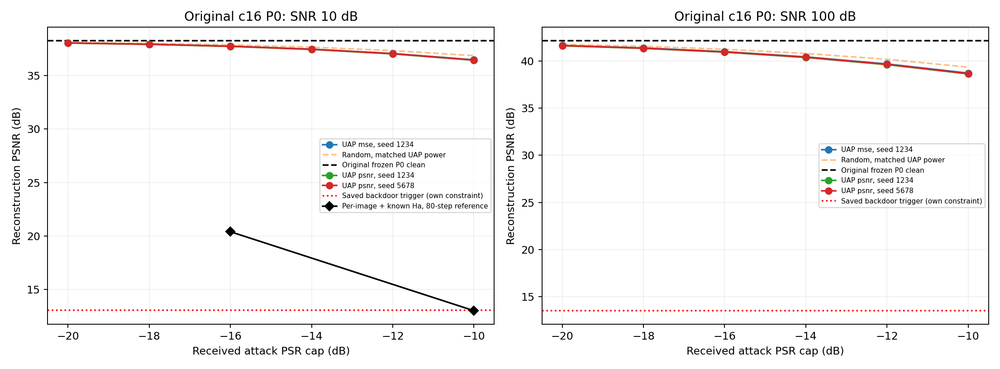
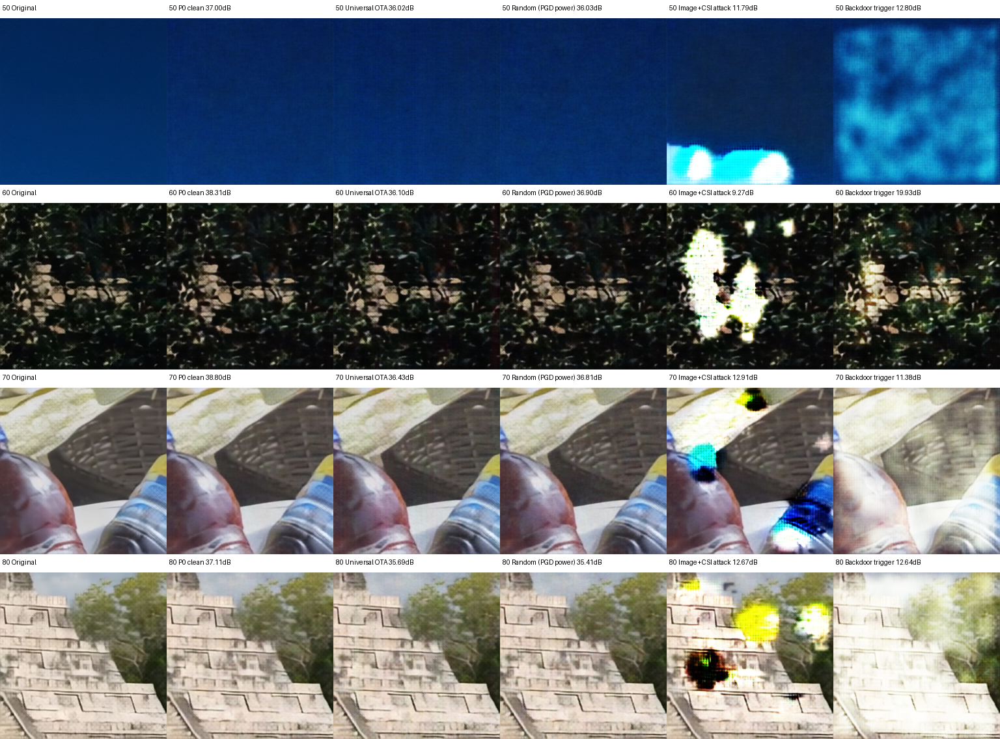

# 原 c16 P0：通用 OTA 与逐图白盒攻击

2026-10-14 已在专用gxhen RTX4090完成，最终PID1982864，退出码0。原c16 P0 checkpoint SHA256为 `24070ef082a37ef5c4a232857daed760442b2fd3850ef617537e39fae5ff8542`，全程权重冻结且逐张量核对未变。没有重训JSCC、没有对P0植入后门。

## 原始质量与实际结果

SNR10下干净P0均值38.272dB；SNR25为41.943dB，SNR100为42.148dB。SNR100与旧P0的42.148dB一致，恢复了原高质量模型基线。两种算法结果必须分开：

**逐图、已知实际攻击Ha的白盒优化**：每个图块独立优化完整1408×64频域扰动，80步Adam，经频域能量投影、相位/时延/频率变换、Ha传播和接收功率裁剪。P0仍冻结；需要当前原图、模型梯度和实际Ha。每个预算50个固定留出图块、1次信道实现，SNR10：

| 接收PSR上限/dB | 同组干净PSNR | 攻击后PSNR | drop | 同功率随机drop | drop的图块95%区间 |
| --- | --- | --- | --- | --- | --- |
| -16 | 38.258 | 20.392 | 17.866 | 0.490 | 17.111–18.617 |
| -10 | 38.258 | 13.002 | 25.256 | 1.693 | 24.572–25.931 |

两组共100行，全部50图的drop都超过3dB；−10dB接收PSR均值为−10.012dB，未靠超过预算获得退化。称为PGD参考只是文件命名：实际是带投影的Adam优化，不是sign-PGD，也不是经证明的全局攻击上界。图像和瞬时Ha已知，不能冒充未知图像/CSI的Magmaw通用攻击。

**通用PGM仍弱**：生成器输入随机z，不以当前图像或Ha为输入，训练时P0白盒；实验仍使用离线接收功率oracle。MSE与直接PSNR两目标各12000步，按验证选择目标再以第二种子训练12000步。最终通用目标测试合计13500行，3个SNR×6预算×50图×5信道重复×3组；不是13500张独立图片。固定共同评估seed20261014和评估Ha池，以下SNR10数值格式为“攻击后PSNR / drop”：

| 目标 | seed | 验证选中step | −16dB | −10dB |
| --- | --- | --- | --- | --- |
| mse | 1234 | 200 | 37.759 / 0.513 | 36.480 / 1.791 |
| psnr | 1234 | 11600 | 37.736 / 0.536 | 36.439 / 1.833 |
| psnr | 5678 | 1200 | 37.749 / 0.523 | 36.460 / 1.812 |

通用PGM没有达到先前理想子载波c16简化攻击的7.195dB，更没有达到后门的失效幅度；不能用逐图白盒25dB掩盖此结果。当前实际攻击传播、载波/CP能量、随机频率/时延与信息条件不同，未作逐项消融，不把差距归因给c16本身。

## 相同接收链路的已保存后门复核

复用强候选权重 `db7fcc8e4bacb743ae780ffdb1a0516319b82d96f5a90893e5ac64182e5d166c` 与原触发JSON，未重新训练。共享P0参考AWGN，回放UAP评估的RNG消耗使同图块/信道重复的干净P0值匹配。各SNR250行，合计750行：

| SNR/dB | 原P0 clean | 原P0加触发 | 后门clean | 后门triggered | 后门drop |
| --- | --- | --- | --- | --- | --- |
| 10 | 38.272 | 36.065 | 38.185 | 13.051 | 25.135 |
| 25 | 41.943 | 38.016 | 41.504 | 13.507 | 27.997 |
| 100 | 42.148 | 38.098 | 41.685 | 13.520 | 28.165 |

−10dB逐图白盒攻击把原P0降到约13dB；保存的后门在相同SNR10下降到约13.05dB。但两者攻击信息与功率约束不同：触发直接在归一化latent施加IQ/DC，OTA是独立Ha后的接收波形叠加，不能由绝对PSNR近似就声称公平强度相当。强后门候选旧验证clean drop0.710dB仍超0.5dB门槛，不因为此次复核改为正式版本。

固定展示keys50/60/70/80，SNR10、OTA接收PSR上限−10dB；使用新的展示信道，未按攻击drop挑图。随机展示匹配逐图攻击功率，通用攻击功率可更低。展示图不是新选模数据。

## 合法链路、能量与门控

合法P0连续复数符号通过64点FFT、CP16、48数据/4导频/12空载波承载。合法信道是P0原单位增益AWGN并已知，不使用QAM硬判决，也不把有噪声LS CE替代原模型链路。攻击走独立合成8抽头Ha、频率排列、相位和分数时延；合法包边界已知，未覆盖未知合法CSI、同步失败、CFO或实机RF。

c16的latent长度65536，合法包1367符号，公共攻击长度固定1408符号。Ha前频域能量投影及Ha后捕获接收上限均保留；后校准只裁剪，不放大学习扰动。随机对照经过同一Ha/变换并匹配学习扰动的捕获接收能量。接收功率裁剪是离线oracle，不是已部署空口功控。PGD参考在每次迭代也遵守同一预算。

首次训练前门控因float32 FFT往返引起0.000256dB差异而停止，尚未训练。可复现探针显示latent误差约1.5e−6；同输入解码无PSNR差、噪声功率符合SNR；改为复数double FFT后配对latent/PSNR误差为0。P0仍float32，未放宽0.0002dB容差。失败门控身份与修复前后探针保留；最后原场景门控通过。

本地静态编译和报告CLI通过；服务器原P0严格加载、FFT/噪声配对门控、有限梯度、P0冻结和逐行功率检查通过。服务器与本地独立审核18条件、4500行/组及样本身份，汇总一致；源码、P0/后门、LMDB及压缩包哈希核对通过；图表已视觉检查。GPU训练/全部模型推理均在专用服务器。

原始metrics、逐图PGD、后门对照与统计已同步本目录。checkpoint和大日志仅保留服务器 `/home/gxhen/Wisig/jscc/deepjscc_backdoor/experiments/magmaw_c16_20261014_01/`。主入口 `scripts/run_magmaw_c16.py`，连续链路 `src/rf_backdoor/magmaw_c16.py`，审核入口 `scripts/report_magmaw_c16.py`；PGD实现位于主入口的 `--pgd-reference` 分支。
