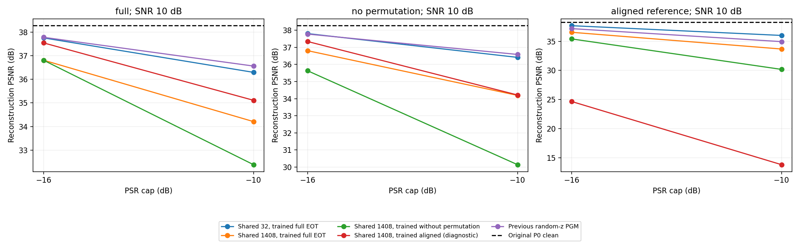

# c16 通用攻击弱效果诊断

2026-10-14 已在专用gxhen RTX4090完成容量/变换消融，退出码0；4500条记录已同步并通过本地独立审核，服务器/本地统计完全一致。目标是原冻结c16 P0，固定DIV2K LMDB train3200、验证keys0–49、测试keys50–99。

四组共享扰动各训练800步：32符号/full EOT、1408符号/full EOT、1408符号/去排列、1408符号/理想对齐。前两组初始发射波形严格相同，唯一改变共享扰动的参数容量；每批所有图片使用同一张量，推理不输入图片/Ha，不做逐图优化。训练统一SNR10、PSR−10、Adam0.05，两个验证预算−16/−10，只按各组训练条件下验证结果选模。

全部候选及原PGM在full、去排列、理想对齐三种测试条件交叉评估，两预算、50图、3信道重复，共4500条。原PGM不重训。理想对齐组假设单位Ha、无相位/时延不确定性，仅作诊断；去排列组去掉一项增强，不能等同于严格full EOT结果。接收功率oracle、原合法单位AWGN等既有限制保留。随机对照统一使用完整长度白随机干扰，经同一变换/信道后匹配接收能量，区别于旧图32符号重复随机对照。

入口：`scripts/diagnose_magmaw_c16_uap.py`、`scripts/launch_magmaw_c16_uap_diagnosis.sh`；审核/图表：`scripts/report_magmaw_c16_uap_diagnosis.py`。checkpoint及大日志留服务器，本地只同步标量指标、配置/身份、哈希与图表。此轮单攻击种子用于诊断，不宣称多种子稳定或论文完整复现。

## 实测结论

下表统一测试在SNR10、PSR−10上限、完整频率排列/随机相位/时延/独立8抽头Ha下，每项50个图块×3信道重复，干净PSNR38.269dB。

| 候选 | 攻击后PSNR | drop | 同功率完整长度随机drop | drop图块95%区间 |
| --- | --- | --- | --- | --- |
| 原random-z PGM，原权重重评 | 36.560 | 1.709 | 1.411 | 1.590–1.816 |
| 32符号共享扰动，full训练 | 36.294 | 1.975 | 1.297 | 1.783–2.157 |
| 1408符号共享扰动，full训练 | 34.209 | 4.060 | 1.429 | 3.844–4.255 |
| 1408符号共享扰动，无排列训练 | 32.385 | 5.884 | 1.408 | 5.512–6.237 |
| 1408符号共享扰动，理想对齐训练 | 35.111 | 3.158 | 1.397 | 2.820–3.472 |

最佳本轮候选在完整变换测试仍有5.884dB drop，不是把测试条件改成无排列。相对同功率随机多下降4.476dB，95%区间4.120–4.817；138/150条记录drop≥3dB。平均接收PSR−10.966dB，无超预算。所有图像共用同一份1408×64复杂频域基础扰动，推理不输入图片或Ha，也不按图更新参数；变换与信道使最终接收波形不同。

容量对照初始发射波形严格一致，相同优化器/训练图像顺序/物理随机种子，32→1408主要改变自由度；结果支持重复短码限制表达能力。无排列训练比从头full训练更强，支持尝试从较容易的变换开始学习；不证明单独移除排列已找到最优训练策略。原PGM还具有随机z、混合SNR/预算、网络参数化和12000步等差别，不能将与共享32的差距单独归因于z。

理想对齐训练的完整共享扰动，在理想对齐测试达到38.269→13.822dB（drop24.447），同一权重在full测试只有3.158dB。因此不知道图片并非唯一障碍，攻击方向对信道/相位/时延变换的稳健性是明显限制。这是多种变换共同变化的诊断，不能据此声称某一种CSI因素单独导致全部损失，也不能把24.447dB作为未知信道通用结果。

下一步候选方案（尚未实现/运行）：保留完整长度共享UAP，先进行无排列训练，再逐步提高排列概率并在完整EOT条件下验证选模；在同一训练批累积多个独立信道的梯度以降低随机性；随后用第二攻击种子和新信道池确认。仍须保留白盒模型、合法单位AWGN和接收功率oracle等限制，不承诺达到逐图白盒25dB。

## 核验与服务器身份

原P0/原PGM/固定LMDB哈希与既有c16实验一致；8份核心源码哈希逐项核对；短/长初始波形等价门控和配对P0基线门控通过。有限数值、频域与接收功率双上限、随机接收能量配对、样本键/重复/条件矩阵、P0权重不变及参数无梯度全部通过。图表已视觉检查。本地静态编译/CLI通过；所有CUDA推理、训练与全量测试均在服务器。

服务器目录：`/home/gxhen/Wisig/jscc/deepjscc_backdoor/experiments/magmaw_c16_uap_diagnosis_20261014_01/`。选模仅使用各自训练条件的验证集。不同候选的测试比较用于本轮探索，不构成多种子确认；后续方案应按完整变换验证集选模，避免按测试drop选checkpoint。
