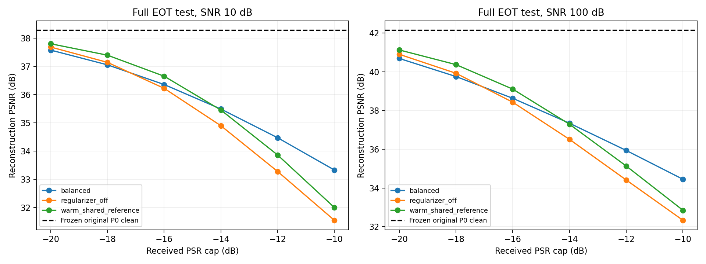
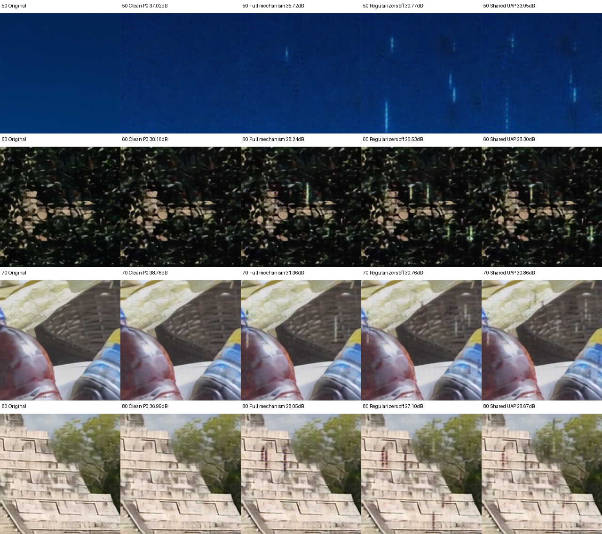
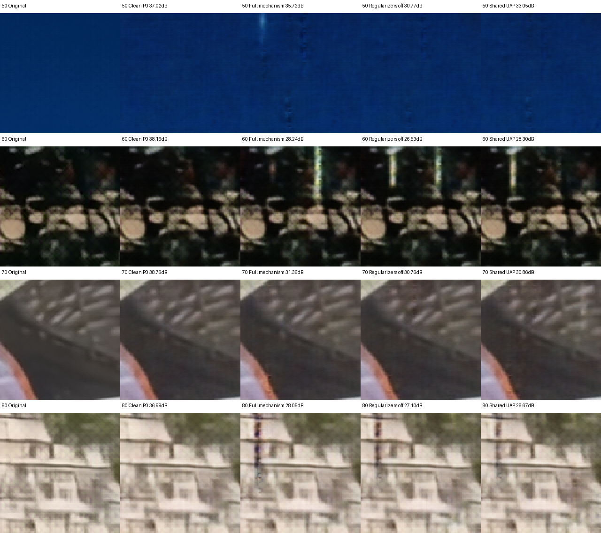

# 完整图像分支机制：c16 通用 OTA 攻击

2026-10-14 第二版已在专用gxhen RTX4090完成，两配置各1600步，连同共享暖启动基线共8100条测试，退出码0。本地14项相关公式/配置/阶段检查、静态编译及CLI通过；CUDA烟测、强制饱和回归和训练后多样性检查通过。源码/模型/数据/压缩包哈希、模型冻结、功率与样本矩阵、服务器与本地独立统计核验通过，图表已视觉检查。首版混合系数饱和导致的随机码塌缩已定位并修正。

## 机制及来源

| 机制 | 实现 | 来源与适配 |
| --- | --- | --- |
| 随机PGM | Uniform(0,1)的100维z，复用ResNet，输出完整1408×64复数扰动 | 论文算法1；完整长度均值+8个QR独立基底和signed-z支路是本地扩展 |
| 重构目标 | 源图像与攻击后重构MSE | 式9图像分支；两z/EOT平均，模型加权求和 |
| 模型集成 | 原P0+随机训练的c16 depth5/width32、depth7/width40，权重1/.25/.25 | 复用已保存独立代理；P0参与训练，仍是白盒 |
| 判别器 | 输入连续OFDM接收后的latent，交替更新D和G | 式11/13符号；D阶段detach攻击，G阶段冻结D参数 |
| 多样性 | 独立z/z'输出距离，raw复数L1另行记录 | balanced使用RMS归一化的元素平均，避免原始范数量纲随长度增大 |
| 物理变换 | K公共长度延拓、Γ子载波排列、M传播前能量投影、随机相位/分数时延、独立8抽头Ha | 式14/15；G直接输出公共长度时K为恒等，仍不读取当前图像/包长 |
| 多次EOT | 每批两个独立物理状态，同一状态比较两z及集成模型 | 本地降低梯度随机性的扩展；训练SNR10/25/100及PSR−16/−12/−10 |
| 排列课程 | 排列概率在前半程由0升到1，后半程全部full变换 | 根据此前消融加入的本地扩展；最终验证/测试始终full |
| 梯度平衡 | 记录重构/判别/多样性梯度，正则系数按相对梯度目标校准并EMA更新 | 本地扩展，目标分别约重构梯度的10%/5%，另有渐增启用及梯度裁剪 |

最小化 `JG = -Lrx + beta_ds*Lds - beta_dv*Ldv`；D最小化 `-Lds`。`literal`配置可保留raw复数L1范数及beta=1，但当前正式对照为`balanced`与同结构`regularizer_off`，两组同初始权重/数据次序/物理随机种子，各1600步。关闭正则组仍训练D用于诊断，但D和diversity不影响G。主目标MSE没有被替换成PSNR；选模使用原P0的full条件验证PSNR降幅。

生成器均值从上一轮完整共享UAP暖启动；已有P0、代理与warm checkpoint均需哈希/形状校验。随机z控制完整长度基底组合，不以当前图片、其编码结果、实际Ha为输入。数据沿用固定DIV2K LMDB train3200，验证keys0–49、测试keys50–99。验证SNR10/100、两个预算，仅用于选模；正式测试3SNR×6预算×50图块×3信道重复，2700条/候选。两种训练配置及暖启动共享基线共8100条。原始训练步数并非论文官方轮数，不声明完整论文数值复现。

保留原P0连续OFDM、已知单位合法AWGN，避免换QAM/有噪声CE降低干净基线。传播前投影及离线接收功率裁剪、同功率完整长度随机控制均保留；后两项使用仿真接收功率oracle。未实现多模态、下游VC/AVE分类攻击、多编码率/调制扫表或RF实机，不能将其写作已完成。合法CSI未知的论文完整系统模型也未被本轮覆盖。

D的测试准确率仅针对同时训练的critic，不能证明面对独立或自适应检测器隐蔽；同时报告扰动输出距离，检查生成器是否实际使用z。

首版确定性探针发现：ResNet输出仍随z变化（std0.0061），但混合系数100%达到tanh饱和（std1.5e−7），最终输出距离约2e−8。首版balanced drop5.670dB、关闭正则6.751dB、同池共享基线6.277dB，不能以PSNR结果掩盖多样性失效。探针和原实验保留在服务器`magmaw_complete_c16_20261014_01`。

第二版保留ResNet，使用带界限的归一化门控和直接signed-z支路，防止神经头忽略随机码；完整I/Q基底通过可微实数QR保持独立，随机分量RMS固定为共享均值的5%，避免收缩到零。这是明确的本地防塌缩扩展。CUDA回归强制神经头偏置1000，仍要求不同z输出有差异；正式验收要求训练后归一化多样性距离≥0.001。功率投影仍作用于完整输出，随机分量不会增加既定能量上限。

入口`src/rf_backdoor/magmaw_complete.py`、`scripts/run_magmaw_complete_c16.py`；启动`scripts/launch_magmaw_complete_c16.sh`。先执行2步CUDA烟测及公式/基线门控，再正式训练；源码、数据、模型/攻击文件SHA、每步损失/系数与部分梯度、冻结状态均记录。checkpoint及大日志保留服务器，本地仅同步配置/身份、标量指标、哈希和图表。

第二版服务器目录：`/home/gxhen/Wisig/jscc/deepjscc_backdoor/experiments/magmaw_complete_c16_20261014_02/`。

## 已完成的效果与核验

全部候选共用新的评估Ha池/随机种子，3SNR×6PSR×50图块×3信道重复=2700行/候选。下表为SNR10、PSR−10上限，均为150行，基线原P0为38.280dB：

| 候选 | 攻击后PSNR | drop | 同功率随机drop | 攻击相对随机优势 | drop图块95%区间 |
| --- | --- | --- | --- | --- | --- |
| balanced完整机制 | 33.331 | 4.950 | 1.485 | 3.465 | 4.494–5.398 |
| 同结构关闭判别/多样性正则 | 31.550 | 6.730 | 1.483 | 5.247 | 6.263–7.215 |
| 暖启动共享扰动重评 | 32.004 | 6.277 | 1.491 | 4.786 | 5.867–6.681 |

完整机制并没有提高本轮PSNR攻击强度；正则关闭的对照更强。不能以功能齐全宣称效果增强，也不能把关闭正则的6.730dB当成完整联合目标的结果。暖启动同池重评6.277dB与上轮5.884dB的信道实现不同，不能把这部分差异算为训练收益。完整机制平均接收PSR−10.919dB，全部记录满足传播前频域约束和离线接收上限，未靠超预算获得退化。

训练后两z输出的RMS归一化平均复数距离分别为balanced 0.056790、关闭正则0.056975，均超过0.001门槛；首版约2e−8的塌缩已消除。两组都保留防塌缩结构，所以关闭diversity损失也有随机变化；本轮不能将随机性完全归因于diversity损失。强制神经头偏置1000的回归，两组均通过。

完整机制该条件下的同时训练critic平衡准确率0.500，关闭正则0.523。该指标可能反映检测器能力不足，不能据此宣称已达到对独立或自适应检测器的隐蔽性。

## 固定图块重构对比

已在服务器复用保存checkpoint生成keys50/60/70/80的重构，SNR10、PSR上限−10dB。严格重放原评估repeat0中对应8图批的噪声、Ha、排列/相位/时延和随机z，12个攻击结果及干净PSNR与保存记录的最大差异0dB；未再次训练、逐图优化或按效果挑图。每列从左到右：原图、正常P0、完整机制、关闭正则、共享暖启动。顶部为单图全图PSNR，不是总体均值。

主要可见竖向条纹和局部亮斑，图像主体仍可辨识。放大统一裁剪像素区域(80,80)–(176,176)，不按不同方法重新选择区域；PNG显示仅作标准[0,1]裁剪及8bit转换，PSNR按原浮点输出计算。GPU推理均在服务器，checkpoint未同步本地。生成入口`scripts/preview_magmaw_complete_c16.py`，逐图指标和功率见`complete_c16_reconstruction.json`；脚本哈希、图像完整性、固定键与逐图指标已本地核验，图像已视觉检查。

仅使用原P0验证keys0–49选checkpoint；模型集成训练中含P0，仍是白盒。测试keys50–99，统计按图块键进行2000次cluster bootstrap；重复信道不是独立图片，也不是攻击训练种子的总体区间。本轮单攻击种子，未完成论文官方训练预算或多种子确认。

本地重核入口：`python scripts/report_magmaw_complete_c16.py results/magmaw_complete_c16_20261014_01/metrics.json --output-dir results/magmaw_complete_c16_20261014_01/local_recheck --plot`。服务器与本地summary逐项一致。10份源码SHA、原P0/暖启动/LMDB身份、公式符号/复数L1/P0配对门控、完整8100行有限数值与能量/键/重复矩阵均通过；三个codec指纹不变且参数无梯度。checkpoint、完整大日志与首版原始实验留服务器。
