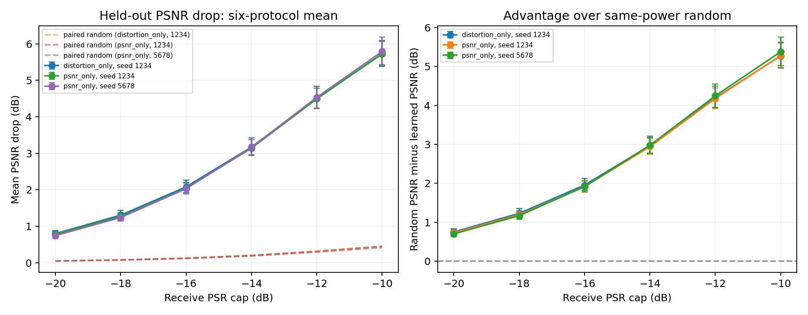
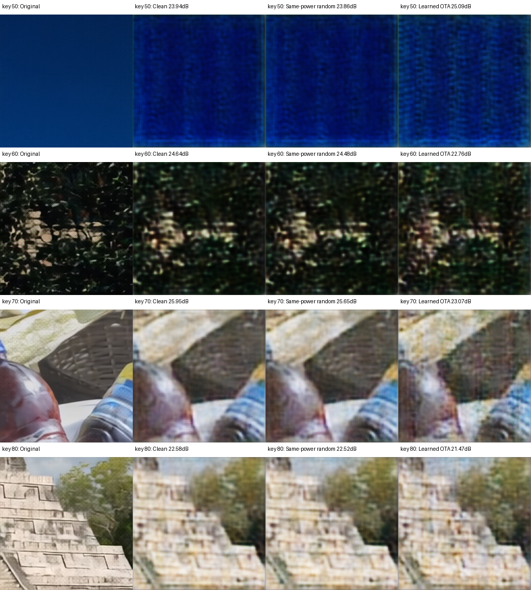

# 以明显降低 PSNR 为目标的 OTA 仿真

2026-10-14 已在专用 gxhen RTX4090 完成，PID1915379，退出码0。两种目标各12000步，直接PSNR目标增加第二训练种子；合计36000训练步、27000条完整目标评估记录。模型、checkpoint和大日志留服务器；本地同步了指标、身份、哈希、统计与图表。

## 主方案结果

按**代理验证集**选择 `distortion_only`（直接最大化MSE，关闭critic/diversity），不是按目标测试挑选。seed1234训练12000步、batch8，验证选中step7400。固定DIV2K训练键0–1599，代理选模valid键0–49，未参与训练的目标模型测试键50–99；复用6个冻结codec，未重新训练codec。

以下均为每个接收PSR预算跨2编码率×3调制×50留出图块×5信道重复的平均值（1500条/预算），所有drop单位dB。干净PSNR总体均值25.093dB。

| 接收PSR上限/dB | 学习攻击drop | 同功率随机drop | 相对随机优势 | drop的图块bootstrap 95%区间 | drop≥3dB比例 |
| --- | --- | --- | --- | --- | --- |
| -20 | 0.798 | 0.049 | 0.749 | 0.720–0.888 | 1.1% |
| -18 | 1.305 | 0.078 | 1.227 | 1.193–1.439 | 5.9% |
| -16 | 2.079 | 0.127 | 1.952 | 1.928–2.264 | 19.5% |
| -14 | 3.170 | 0.202 | 2.969 | 2.960–3.417 | 47.0% |
| -12 | 4.509 | 0.316 | 4.193 | 4.233–4.831 | 75.3% |
| -10 | 5.719 | 0.449 | 5.270 | 5.385–6.090 | 86.5% |

−16dB条件下98.0%的测试记录PSNR下降；−10dB下99.93%下降。攻击并非每张图每次信道都有效，区间按图块键重采样，也不能代表训练种子总体不确定性。

## 两目标与种子对照

| 目标 | 训练seed | 验证选中step | 代理验证drop | −16dB目标drop | −14dB目标drop | −12dB目标drop | −10dB目标drop |
| --- | --- | --- | --- | --- | --- | --- | --- |
| distortion_only | 1234 | 7400 | 1.697 | 2.079 | 3.170 | 4.509 | 5.719 |
| psnr_only | 1234 | 11600 | 1.623 | 2.038 | 3.141 | 4.492 | 5.730 |
| psnr_only | 5678 | 10700 | 1.583 | 2.031 | 3.158 | 4.533 | 5.790 |

两种目标结果接近，不宣称MSE统计显著胜出。直接PSNR目标完成第二种子独立复跑，**MSE主方案仍只有一个训练种子**；新种子也改变信道池和评估随机实现，不能将组间差异归因为纯训练种子效应。信道重复不等于训练种子重复。每组完整9000行，36条件细表在 `primary/report/summary.csv` 和 `confirm/report/summary.csv`。

## 重建与功率

固定展示key50/60/70/80、c8、16-QAM、接收PSR上限−16dB，使用独立的新信道实现，未用于统计选模。保留key50的反例：该次攻击使PSNR提高约1.15dB；其余三个图块分别下降约1.88/2.88/1.12dB。展示图没有按目标drop筛选。

训练仍在Ha前进行能量投影，不使用实际Ha作功率后校准。验证与测试对捕获的接收波形增加离线上限，随机模板经过同一Ha、频率排列、相位和时延后逐条严格匹配学习攻击的接收功率。三种重建共享合法信道和AWGN。接收上限和匹配是仿真标准化，不是已实现的空口功控。

本轮学习扰动同时通过Ha前频域预算和Ha后捕获接收预算审核；随机接收PSR与学习扰动逐条相差不超过0.0001dB。旧未限定接收PSR的6.875dB最大条件值不作为本轮同功率提升基线。

## 验证与复用

本地5项解析测试和静态编译通过；服务器CUDA投影、范数、梯度符号、接收功率裁剪和随机匹配检查通过。服务器与本地分别审核36条件、样本身份、所有逐条功率约束，汇总完全一致；训练源码、codec和数据哈希核对通过，图表已视觉检查。完整metrics包含训练历史与逐样本指标。

源码：`scripts/run_magmaw_effective.py`、`src/rf_backdoor/magmaw_effective.py`；运行入口 `scripts/launch_magmaw_effective.sh`；[目标、公式、功率参考与数据划分](../../docs/magmaw_effective_attack.md)。服务器目录 `/home/gxhen/Wisig/jscc/deepjscc_backdoor/experiments/magmaw_effective_20261014_01/`，checkpoint为 `runs/primary/distortion_only_best.pt`、`runs/primary/psnr_only_best.pt`、`runs/confirm/psnr_only_best.pt`。

这是图像分支、替代codec和DIV2K的合成OTA仿真；未进行实机RF。保留codec原MMSE CE训练与本轮LS CE接收存在失配，所有对照使用同一接收器。报告以攻击效果为目标，不作为官方模型上的Magmaw数值复现。
