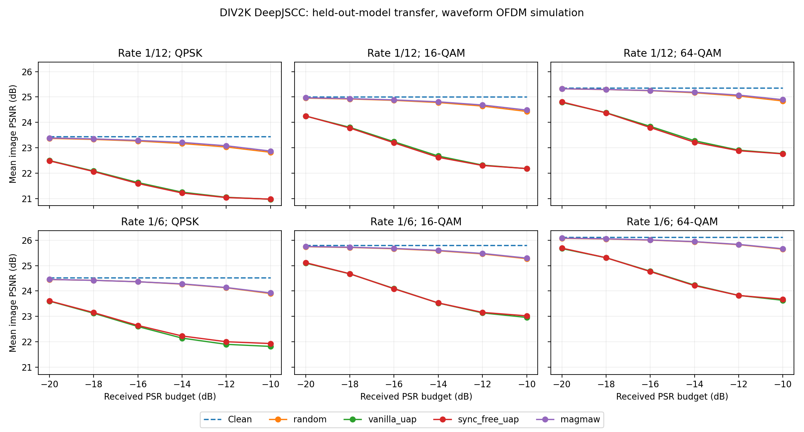

# Magmaw 图像全量适配：最终结果

2026-10-13，在 gxhen RTX 4090 完成；正式任务退出码 0。服务器根目录：
`/home/gxhen/Wisig/jscc/deepjscc_backdoor/experiments/magmaw_image_full_20261013_01/`。

已完成 6 个干净 codec 各 5000 steps，以及 Magmaw、vanilla UAP、sync-free UAP 各 60 epochs（每 epoch 全部 1600 个攻击分区样本、200 batches）。固定 DIV2K Cosmos CV16 LMDB；代理/攻击训练键 0–1599，目标训练键 1600–3199；验证键 0–49、最终留出键 50–99。目标模型不参加攻击训练/选模。

最终矩阵：2 rates（1/12、1/6）×3 modulations（QPSK、16/64-QAM）×6 PSR（-20:2:-10）×5 独立信道重复×50 留出图块，共 36 条条件、9000 条记录，每条比较 clean、random、vanilla、sync-free 和 Magmaw。报告脚本已核验矩阵完整、每个样本/重复组合无缺失无重复、实际接收 PSR 未超预算。只有一个训练种子 1234，5 次信道重复不是多训练种子。

**最终结论：Magmaw 在全部条件中的最大平均 PSNR drop 为 0.600188 dB。没有复现论文图像攻击最高 8.04 dB 的退化，不能宣称复现成功。** 之前 pilot 的 7.195 dB 是另一条白盒连续 latent 链路的结果，不与本轮黑盒目标迁移/QAM-OFDM 结果混称。本轮 Magmaw 在全部 36 条条件中弱于 vanilla/sync-free，仅 1/36 条条件略强于随机干扰；没有证明判别器与 diversity 正则带来优势或 stealth。

16-QAM 下的最终目标迁移 PSNR drop（dB，每行 50 图块×5 信道重复）：

| 编码率 | PSR | 随机干扰 | Magmaw | vanilla UAP | sync-free UAP |
| --- | --- | --- | --- | --- | --- |
| 1/12 | -16 dB | 0.145 | 0.127 | 1.776 | 1.819 |
| 1/6 | -16 dB | 0.138 | 0.126 | 1.707 | 1.716 |
| 1/12 | -10 dB | 0.582 | 0.528 | 2.834 | 2.833 |
| 1/6 | -10 dB | 0.529 | 0.507 | 2.844 | 2.782 |

36 条条件各自求平均后的最大 drop 为 random 0.624 dB、Magmaw 0.600 dB、vanilla 2.844 dB、sync-free 2.833 dB；这些最大值可能来自不同条件，不能当作同一条件的直接对照。各条件完整数值见 `summary.csv` / `summary.json`；逐样本结果与代码/配置/数据身份见 `metrics.json`。

已同步的 clean codec 指标 `codec_metrics.json` 中，两目标的最佳 16-QAM 验证 PSNR 为 24.733 dB（1/12）、25.378 dB（1/6）；这不是最终测试条件的干净 PSNR。

服务器已生成：

- `runs/full/metrics.json`：完整最终逐条件数据、环境、源码/配置/数据 identity。
- `results/full_report/summary.json`、`summary.csv`：36 条条件汇总。
- `results/full_report/transfer_psnr_matrix.png`：六子图结果图。
- `results/full_metrics_bundle.tar.gz`：仅指标、配置 identity、训练历史、图表与退出码，不含 checkpoint/大日志。

本地同步状态：完整指标包已通过 SSH 标准输出取回并按固定文件名单安全解包（SCP 连续两次因网络失败后停止）；已同步 `metrics.json`、`identity.json`、6 个 codec 指标、3 个完整 attack 训练历史、summary、图表、退出码和短合约测试结果。重新在本地运行报告脚本，验证 36 条条件、9000 条记录、逐样本/重复身份、PSR 上限、源码哈希与退出码；图表已视觉检查。checkpoint 与大日志未下载。

Magmaw 选中 epoch 3，vanilla epoch 59，sync-free epoch 60，均只用代理验证集选模。训练日志显示 MSE 与判别器/diversity 项数值尺度不同，损失尺度/正则强度是后续待验证假设；这轮没有做改变损失权重的因果消融，不能断言其导致失败，也没有根据目标测试调参。

边界：图像单模态、DIV2K 替代、独立本地卷积代理与目标、合成 2000+2000 攻击信道池、接收功率 oracle、已知 victim 包边界、无真实 RF。PGM 层规模对齐公开残差生成器；判别器为本地 Conv1d；初始化采用 PyTorch 默认。MSE 在代理间求和、判别器项在代理间平均、diversity 为逐元素均值，训练预算为本轮选择，不能冒称论文原训练预算。未验证 stealth 检测或多模态/下游任务。方法对齐与差异详见 `docs/magmaw_image_full.md`。
