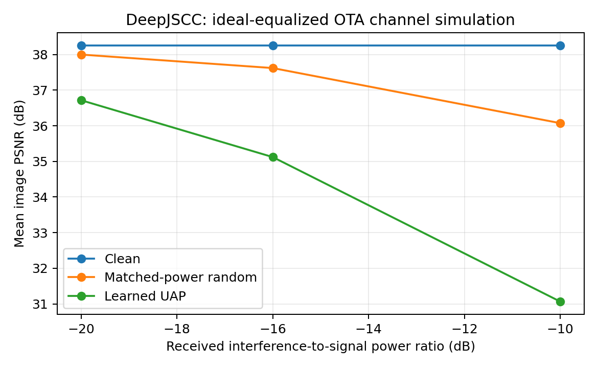

# Magmaw-inspired DeepJSCC OTA 仿真结果

2026-10-13，gxhen RTX 4090，PyTorch 2.7.1+cu118。复用现有干净 P0、固定 Cosmos DIV2K LMDB；模型冻结，无数据投毒。生成器 400 步、batch 4、Adam 1e-3、seed 20261013，训练 SNR 10 dB / PSR -16 dB。训练样本 3200，验证键 0–49，测试键 50–99。验证集第 300 步最优（drop 3.169780 dB）；没有在留出集选模。

| 接收端 PSR | 干净 PSNR | 随机干扰 PSNR | UAP PSNR | UAP drop | 比随机干扰多降 |
| --- | --- | --- | --- | --- | --- |
| -20 dB | 38.260 | 38.000 | 36.719 | 1.541 | 1.282 |
| -16 dB | 38.260 | 37.621 | 35.122 | 3.137 | 2.499 |
| -10 dB | 38.260 | 36.074 | 31.065 | 7.195 | 5.010 |

每行都是同一生成器在 50 张留出图块上的平均 PSNR（dB），合法 AWGN、攻击信道、时延、相位和排列的随机状态在同功率随机/UAP 对照间配对。实际 PSR 最大误差低于 0.000002 dB。

- `psr_minus{20,16,10}_metrics.json`：原始逐样本指标、数据/模型/源码哈希与服务器环境。
- `summary.csv`、`summary.json`：汇总与样本配对 t 区间；-16 dB UAP drop 95% 区间 [2.790, 3.485] dB，较随机额外下降区间 [2.160, 2.838] dB。该区间只描述固定训练种子下样本差异，不是多种子结论；原 LMDB 图块存在来源相关性，因此不能当作独立原图总体推断。
- `manifest.json`：训练、恢复评估及功率扫描的审计记录。

服务器实验根目录：`/home/gxhen/Wisig/jscc/deepjscc_backdoor/experiments/magmaw_ota_20261013/`。原生成器 `runs/pilot_eot/generator.pt`，完整评估 `runs/pilot_eot_evaluated/metrics.json`，功率扫描 `runs/pilot_eot_psr-20/`、`runs/pilot_eot_psr-10/`。checkpoint 和大日志未下载。评估和扫描退出码均为 0，数值测试 2 项通过。首次测试收集失败因父项目 pytest 导入路径，已显式禁用父配置；训练完成后首次留出评估失败因 LMDB 同库重复句柄，修正并加载原 generator 后评估成功，没有为修复错误重训或重新选模。恢复评估 metrics 的 `history` 为空，训练选模记录在 manifest 中。

结论仅覆盖单模型白盒、理想均衡数据子载波级 OTA 信道仿真。合法链路为单位增益 AWGN，攻击者为独立三径。使用合法 burst 接收功率校准 PSR，属于 oracle 功率假设；未验证发射功率预算、未知 CSI、多模态、黑盒迁移、CP/pilot/同步/CFO、真实 OFDM 服务或射频 OTA，未实现论文判别器与 diversity 正则。随机基线是经过相同延拓/排列/信道的随机模板，不等同于全时域独立高斯干扰。完整方法边界见 `docs/ota_adversarial_magmaw.md`。
