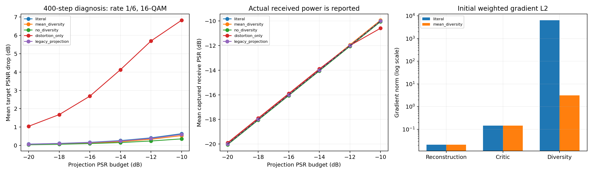

# 算法精读后的式级复现与控制实验

2026-10-14 在 gxhen RTX 4090 完成；PID 1911944，退出码 0。服务器目录 `/home/gxhen/Wisig/jscc/deepjscc_backdoor/experiments/magmaw_paper_20261014_01/`，日志 `pipeline.log`。复用先前6个干净codec，不更新它们；数据仍为固定 DIV2K，攻击训练键0–1599、验证0–49、目标测试50–99。固定一个训练seed1234。

## 实测结果

| Profile | 更新步数 | βds/βdv | Ldv归约 | 投影位置 | 代理选模drop | 目标最大条件均值drop |
| --- | --- | --- | --- | --- | --- | --- |
| literal | 400 | 1/1 | 复数L1范数 | Ha前 | 0.105 | 0.694 |
| mean_diversity | 400 | 1/1 | 复数幅度均值 | Ha前 | 0.092 | 0.581 |
| no_diversity | 400 | 1/0 | 不启用 | Ha前 | 0.051 | 0.403 |
| distortion_only | 400 | 0/0 | 不启用 | Ha前 | 1.960 | 6.875 |
| legacy_projection | 400 | 1/1 | 复数L1范数 | Ha后、完整长波形 | 0.101 | 0.636 |
| literal full | 12000 | 1/1 | 复数L1范数 | Ha前 | 0.120 | 0.682 |

所有drop单位dB。最大值来自每个 profile 的36条协议/名义预算条件中最大均值，可能来自不同条件，不是严格同条件对照。完整组batch8，相当于1600攻击样本循环60epochs，step1300由代理验证选中；5个400-step组batch4，分别3600测试行（36条件×50图块×2信道重复），合计18000；完整组9000行（5次信道重复）。目标模型没有用于优化或选模。

**没有复现论文的Magmaw攻击效果。6.875dB是关闭两个正则的对照，不是完整Magmaw，也不能与论文8.04dB计算复现率。** 当前是图像子集、替代数据/模型、合成CSI、自定义critic和显式能量参考约定。保留旧QAM codec的同时切换为论文LS CE存在接收端失配；详见算法精读文档。

初始加权gradient L2：重建0.020882、critic0.144613、字面diversity6440.817，mean-diversity3.14493。去掉diversity后，再关闭critic使代理选模drop从0.051升至1.960dB；这是当前后端与400-step预算下的因果消融证据，不代表论文多模态网络。Adam的自适应更新也意味着不能直接把gradient范数比当作参数位移比例。

## 功率与审核

新算法的式(14)频域能量投影在Ha之前。用已知公共上界固定发射704符号，再由接收器捕获重叠窗口；预算参考为合法接收有效区间的平均功率，不使用实际Ha做后校准。频域约束、完整发射功率和最终捕获接收PSR分别记录。实际接收PSR可因Ha高于名义预算；不要把这些结果和旧版严格接收PSR校准实验混称为同功率对照。

所有Ha前 profile 的频域约束在数值误差0.000002dB内通过。legacy_projection只约束完整Ha后长波形，短窗口功率不必满足相同平均约束；诊断capture窗口最大超过预算0.0034dB。完整区间能量没有存于逐行指标，报告明确标为无法单凭行数据审核。曾错误用capture量检查legacy；已通过解析反例修正报告，不改变训练或放宽字面公式约束。

本地4项解析oracle通过；CUDA投影/L1值和minimax梯度符号检查通过。报告脚本在服务器与本地独立核验36条件、样本/重复身份、频域约束；源码哈希和退出码核对通过；图表已视觉检查。完整指标、identity、公式检查、梯度历史和汇总在本目录，checkpoint与大日志只留服务器。首个SSH二进制传输超时后改用SCP成功，未因此重训。

`upstream_complex_product_probe.json`记录对官方固定提交的纯算术AST探针：输入i、Ha=i时，公开表达式实部为0，理论为-1。未执行其上游模块，未修改第三方源码；本轮原生复数传播正确。只针对该公开提交，不推断作者实际实验实现。

代码与公式映射见 `docs/magmaw_algorithm_reading.md`；运行入口 `scripts/run_magmaw_paper.py`，报告入口 `scripts/report_magmaw_paper.py`。完整数据哈希、6个codec身份、源码哈希在两个metrics文件中。当前只有一个训练种子，信道重复不构成多训练种子复现。
